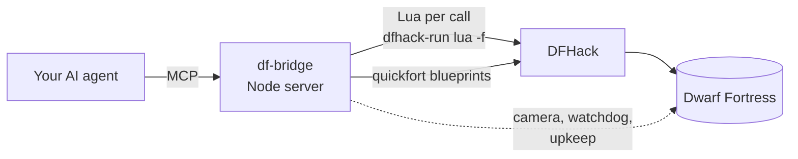

```text
    ____ _       _____    ____  ______   __________  ____  __________  ________________
   / __ \ |     / /   |  / __ \/ ____/  / ____/ __ \/ __ \/_  __/ __ \/ ____/ ___/ ___/
  / / / / | /| / / /| | / /_/ / /_     / /_  / / / / /_/ / / / / /_/ / __/  \__ \\__ \
 / /_/ /| |/ |/ / ___ |/ _, _/ __/    / __/ / /_/ / _, _/ / / / _, _/ /___ ___/ /__/ /
/_____/ |__/|__/_/  |_/_/ |_/_/      /_/    \____/_/ |_| /_/ /_/ |_/_____//____/____/
                               ___  ___  _______  _________
                              / _ )/ _ \/  _/ _ \/ ___/ __/
                             / _  / , _// // // / (_ / _/
                     =====  /____/_/|_/___/____/\___/___/    =====
```

<div align="center">

**Your AI plays Dwarf Fortress. You grab a drink and watch.**

An MCP server that gives any AI agent 57 tools to run a real Dwarf Fortress fortress through DFHack,<br>
from the first dig to sieges, caravans, nobles and guildhalls, with a camera that shows you the action.


</div>

---

## Contents

- [What it's like](#what-its-like)
- [Quick start](#quick-start)
- [Connect your AI](#connect-your-ai)
- [Settings](#settings)
- [The tools](#the-tools)
- [How it works](#how-it-works)
- [Tales from real forts](#tales-from-real-forts)
- [What the bridge knows about DF v50+](#what-the-bridge-knows-about-df-v50)
- [Development](#development)

## What it's like

Start Dwarf Fortress, connect your AI, and say *"play my fort"*. The AI becomes the overseer; your game window
becomes a live view of what it is doing.

- **Time runs in short, watched steps.** The game unpauses for a few days at a time and stops the moment something
  matters: a goblin thief at the map edge, a citizen in a fight, a death, a strange mood, a caravan, a migrant wave.
- **The camera follows the story.** It jumps to fights and arrivals, tracks intruders, and tours interesting work
  when nothing is happening: a new bedroom wing being dug, a masterwork leaving the forge. Captions in the game's own
  announcement log say what you are looking at.
- **The AI explains itself.** It reports what it saw, what it decided and why, and asks you before anything you
  would want a say in.
- **It plays fair.** Everything goes through the game's own systems: designations, work orders, zones, the trade
  screen, petitions. Nothing is spawned, teleported or revealed.

Tell the camera what you like watching, and it remembers:

```
df_camera like categories=["fights","hostiles","building","diplomacy"]
df_camera dislike categories=["farming"]
```

## Quick start

1. Install **Dwarf Fortress** and the free **DFHack** app on Steam, then launch the game. DFHack starts with it.
2. Install the bridge (needs [Node.js](https://nodejs.org) 18+):
   ```bash
   git clone https://github.com/nutshot2000/Dwarf-Fortress-Bridge.git
   cd Dwarf-Fortress-Bridge
   npm install
   ```
3. Connect your AI (next section), load or embark on a fort, and tell it to play.

If the game isn't installed under `D:\SteamLibrary`, set `DF_DIR` and `DFHACK_DIR` (see [Settings](#settings)).

`df_screenshot`, which lets vision models look at the real game window, works on Windows. Everything else works
wherever Dwarf Fortress and DFHack run.

## Connect your AI

It's a standard **MCP stdio server**, so any client that speaks MCP can run it. Replace the path with yours.

`df_wait` can run for up to 50 real seconds per call, so give the server a tool timeout of at least 60 seconds,
or lower `DF_WAIT_SECONDS`.

<details open>
<summary><b>Claude Code</b></summary>

```bash
claude mcp add -s user dwarf-fortress -- node /path/to/Dwarf-Fortress-Bridge/src/server.js
```
</details>

<details>
<summary><b>Codex</b> (<code>~/.codex/config.toml</code>)</summary>

```toml
[mcp_servers.dwarf-fortress]
command = "node"
args = ["/path/to/Dwarf-Fortress-Bridge/src/server.js"]
tool_timeout_sec = 120
```
</details>

<details>
<summary><b>OpenCode</b> (<code>opencode.json</code>)</summary>

```json
{
  "mcp": {
    "dwarf-fortress": {
      "type": "local",
      "command": ["node", "/path/to/Dwarf-Fortress-Bridge/src/server.js"],
      "enabled": true
    }
  }
}
```
</details>

<details>
<summary><b>Hermes Agent</b> (<code>~/.hermes/config.yaml</code>)</summary>

```yaml
mcp_servers:
  dwarf-fortress:
    command: node
    args: ["/path/to/Dwarf-Fortress-Bridge/src/server.js"]
    timeout: 120
```
</details>

<details>
<summary><b>OpenClaw</b> (<code>mcp.servers</code> in your OpenClaw config)</summary>

```json
{
  "mcp": {
    "servers": {
      "dwarf-fortress": {
        "command": "node",
        "args": ["/path/to/Dwarf-Fortress-Bridge/src/server.js"]
      }
    }
  }
}
```
</details>

<details>
<summary><b>Cursor, Claude Desktop, Gemini CLI, Windsurf and most others</b> (<code>mcpServers</code> JSON)</summary>

```json
{
  "mcpServers": {
    "dwarf-fortress": {
      "command": "node",
      "args": ["/path/to/Dwarf-Fortress-Bridge/src/server.js"]
    }
  }
}
```
Cursor: `.cursor/mcp.json` · Claude Desktop: `claude_desktop_config.json` · Gemini CLI: `~/.gemini/settings.json`
</details>

Config formats change between client versions; if a snippet doesn't load, check your client's MCP docs.

**The playbook.** The server sends [`PLAYBOOK.md`](PLAYBOOK.md) to the model as its instructions: the turn loop,
the no-cheating rule, and how to use each tool well. Some clients drop server instructions; if yours does, start
with *"call df_help topic=playbook first"*.

## Settings

All optional, set in the server's `env`:

| Variable | Default | What it does |
|---|---|---|
| `DF_TOOLS` | `full` | `full` = all 57 tools · `core` = 24 essentials, for clients with tool limits or smaller models · or a comma-separated list of tool names |
| `DF_AGENT_NAME` | `Overseer` | The name on camera captions in the game's announcement log, e.g. `Codex` or `Hermes` |
| `DF_WAIT_SECONDS` | `50` | Real-time cap for one `df_wait` call; keep it under your client's tool timeout |
| `DF_DIR`, `DFHACK_DIR` | `D:\SteamLibrary\...` | Where Dwarf Fortress and DFHack are installed |

## The tools

| Group | Tools |
|---|---|
| Observe | `df_status` `df_problems` `df_units` `df_unit` `df_look` `df_paths` `df_announcements` `df_alerts` `df_screenshot` |
| Diagnose | `df_threats` `df_items` `df_squad_status` `df_mood` `df_stocks` `df_designations` `df_jobs` |
| Build | `df_dig` `df_build` `df_stockpile` `df_zone` `df_blueprint` `df_rooms` `df_room_plan` `df_remove` `df_minecart` |
| Produce | `df_order` `df_upkeep` `df_workshop` `df_crop` `df_kitchen` `df_pile` `df_dump` |
| People | `df_labor` `df_noble` `df_location` `df_standing` `df_animals` `df_petition` `df_justice` |
| Defence | `df_military` `df_schedule` `df_burrow` `df_levers` |
| Trade | `df_trade` |
| Time | `df_wait` `df_pause` `df_resume` `df_save` |
| Camera and UI | `df_camera` `df_view` `df_ui` `df_screen` `df_tutorial` |
| Expert | `df_auto` `df_cmd` `df_lua` `df_help` |

Some of what they do beyond the obvious:

| | |
|---|---|
| **Watchdog** (`df_wait`) | Runs time in steps and stops for hostiles, citizen fights, deaths, moods, caravans, migrants, petitions and citizens who lose their way out. Clicks away popups, names any panel that froze the clock, and repeats the notices in DFHack's corner box (traders ready, unmet guildhall agreements, mandates near deadline). Can sound the civilian alert and ready the squads by itself. |
| **Upkeep** | Keeps drink, food storage, spare furniture, goblets, soap and fuel topped up with work orders, without ever doubling an order. |
| **Threats** | `df_threats` finds disguised werebeasts, vampires and necromancers, and lists who killed whom. `df_petition` vets every petitioner before you accept them. |
| **Rooms** | Bedroom wings in three calls (dig, furnish, zone), protected walls that later digs can't break, value and requirement audits for every zone, and pedestals and display cases stocked in one call. |
| **Navigation** | `df_paths` measures real walking distances (stairs and ramps included), so you can see which trips are long and check a new corridor or stairwell before and after. |
| **Military** | Squads, uniforms, schedules, patrols, burrows and levers. `equip` fills empty uniform slots, prefers real armour over clothing, upgrades to better pieces, and never takes another squad's kit. |
| **Trade** | Marks goods (unpacking them from bins), refuses artifacts and export-banned items, drives the trade screen and shows the merchant's reply. |
| **Safety nets** | `df_dig` warns before you dig under an aquifer, keeps a shaft's stair marks when a tunnel crosses it, and can preview (`dry_run`). Every tool rejects misspelt arguments instead of silently ignoring them. |

## How it works



Each tool runs a short Lua script through `dfhack-run`. Digging, buildings, stockpiles and zones go through DFHack's
`quickfort`; menus that only the UI can drive (trade, petitions, display assignment) are clicked through the game's
own screens. There is no game mod and nothing is injected.

A turn looks like: `df_status` → `df_problems` → one action → `df_wait upkeep=true`, with the camera showing each
step.

## Tales from real forts

The bridge was written by Claude while playing; most of its tools exist because something went wrong.

**Flagringed** (year 103–104, 100 dwarves, now a Town)

- **The flooding quarry.** A quarry dug one level under a light aquifer slowly filled with water. The stair ring was
  walled off and the quarry moved two levels down; `df_dig` and `df_look` now warn about tiles under aquifers.
- **The chinchillas and the keas.** Keas (thieving parrots) kept stealing bolts and killing chinchilla kits in the
  surface garden. Chinchillas don't need grass, so the herd moved into an underground burrow off the tavern, and a
  crossbow squad, the Kea Bane, was formed with an archery range and a stair straight up to the surface.
- **The guildhalls nobody counted.** Three temple and guildhall agreements were abandoned even though the rooms
  existed. A bare zoned room is worth about 25 and the game calls it a "meeting place"; the agreement wants a real
  guildhall. An artifact quern on a pedestal lifted one hall to 8,139 and its agreement was satisfied the same week.
- **Snatchers.** Goblin thieves came for the children twice. The civilian alert and both squads drove them off; the
  militia commander killed one.
- **Exploration pays.** A shaft extended eight levels down struck magnetite, native platinum and gypsum in the first
  tunnels.

**Spearmirrors** (the first fort)

- **The well that ran dry.** The surface pool drained, so the overseer dug a one-tile shaft 40 levels down into the
  first cavern's lake.
- **The werebeast.** A wereiguana arrived disguised as a human and killed four children. Two dwarves it had bitten
  turned at the next full moon. That's why `df_threats`, the watchdog and petition vetting exist.
- **The stalled diplomat.** A royal treasurer refused to meet without a decent office; the overseer dug one,
  engraved it and furnished it in iron.
- **The yarn crisis.** A fey weaver needed wool cloth nobody had. With cheating ruled out, the answer was the
  dwarven caravan, and the mood ended in an artifact shirt.

## What the bridge knows about DF v50+

<details>
<summary><b>Game quirks the tools work around</b> (useful if you script DFHack yourself)</summary>

**Digging and water**
- A light aquifer drips into open tiles directly beneath it, so the level right under an aquifer layer floods
  slowly. Water on a floor makes nearby rock "damp" and silently cancels digs; designating the same tiles again
  confirms them.
- A plain dig over a pending stair mark replaces it, and a dig directly under a stair can't be reached, so a shaft
  stalls with every miner idle. `df_dig` keeps stair marks.
- Dig jobs clear the tile's dig flag once a dwarf takes them; `df_look` overlays queued dig jobs.
- quickfort's engrave key designates nothing in v50; `df_dig kind=engrave` sets it directly.

**Work and workshops**
- Work orders need a manager. If the game says "A manager is required" although one is appointed, `df_noble
  action=repair` rebuilds the index the game checks.
- Many v53 workshop items (wooden chairs, shields) are reactions that need an edged tool; the native "construct"
  jobs for hatch covers and thrones need none.
- A workshop with linked "give" stockpiles takes every input only from them, empty barrels included.
- DFHack has no task catalogue for bowyers, clothiers or kennels; the bridge adds bowyer jobs and points to
  `df_order` for the rest.
- Workshop queues run front to back and ignore the do-now flag; `df_jobs do_now` moves a job forward.
- Farm plots reset to fallow when construction finishes, so set crops afterwards.

**Rooms, locations and nobles**
- Temple and guildhall agreements need the location to reach tier 1 (a guildhall reached it at about 2,500 value);
  they are abandoned after about a year. Artifacts and masterwork crafts on display raise the value.
- A temple dedicated to a religion is set through the location's deity fields; a guildhall needs its guild's
  profession, which a guild's name doesn't tell you ("The Mechanical Guild" is craftsdwarves).
- Recognizing a temple's priesthood is a button in the location details panel, which only draws when opened with
  the right context; `df_location action=priesthood` presses it and can appoint the priest.
- Diplomats meet nobles in an office of decent quality, or the meeting and depot trading stall.
- Tombs hold one body each: put a 1x1 tomb zone on every coffin.
- Every location quickfort creates gets the same generated name; `df_zone` sets the requested one.

**Military**
- Soldiers only fetch items listed in their position's assigned items; `df_military equip` keeps that in sync.
- A crossbow uniform applied from a script has no ammunition entry, so marksdwarves never pick up bolts; the bridge
  adds one.
- In an off-duty month soldiers change into civilian clothes and drop their uniform where they stand.
  `df_squad_status` says so; `train routine=constant` keeps a squad in uniform.
- Kill orders are ignored for members of a civilization the game doesn't count as hostile, such as a werebeast in
  human form or a visitor. Wild creatures are hunted down even though the game doesn't flag them as dangerous.

**Trade and animals**
- Marking an item for trade while it sits in a bin never creates a haul job; `df_trade send` unpacks it first.
- Elves are offended by wood and animal-product goods.
- DFHack's autobutcher, once enabled, culls every species unless `noautowatch` is set first.
- Guard dogs in a pasture can kill other animals there once those revert to wild.

**Interface**
- Panels (trade, squads, petitions, building sheets) ignore Esc sent from scripts and some freeze time; `df_ui close`
  shuts them. Popups pause the game until their Okay button is clicked; `df_wait` clicks them.
- A seasonal autosave freezes time for a while at the start of each season.
- Follow mode switches itself off, so the camera director follows units itself.

**Leftovers**
- Gear of the dead is forbidden where it falls, and invaders' gear is flagged foreign; haulers ignore both until
  cleared. `df_problems` counts it.
- Dumps forbid what lands in them; `df_dump action=unforbid` makes dumped stone usable again.
- The game's walkability map treats locked doors and hatches as open, so a dwarf shut out behind one never shows as
  trapped; the bridge's access check walks around locks itself.
- An item can stay "held" by a unit that no longer exists, so nobody can ever pick it up.

</details>

## Development

| Path | What's there |
|---|---|
| [`PLAYBOOK.md`](PLAYBOOK.md) | The model's operating guide, sent as the server's instructions |
| [`AGENTS.md`](AGENTS.md) | Notes for AI coding agents working on the bridge |
| `src/server.js`, `src/core.js` | Server start, tool registration, settings and helpers |
| `src/camera.js` | The camera director |
| `src/tools/*.js` | Tools, one file per area |
| `lua/` | The DFHack Lua behind each tool |
| [`CHANGELOG.md`](CHANGELOG.md) | Notable changes per release |
| [`FORTRESS.md`](FORTRESS.md), [`ISSUES-REVIEW.md`](ISSUES-REVIEW.md), [`TUTORIAL-VALIDATION.md`](TUTORIAL-VALIDATION.md) | Play logs and test reports |

- Try one tool: `node scripts/call.mjs df_look "{\"radius\":20}"`
- Several calls in one server session (the camera keeps state in the server):
  `node scripts/session.mjs '[["df_camera",{"action":"follow","name":"Urist"}],["df_wait",{"days":1}]]'`
- `npm run test:offline` checks that every tool registers; `npm test` runs every read-only tool against the running
  game and changes nothing.
- Lua files reload automatically when edited. Changes under `src/` need the MCP server restarted;
  `scripts/call.mjs` always starts a fresh server, so it tests new JS right away.

<div align="center">

*Strike the earth!* ⛏️

</div>
