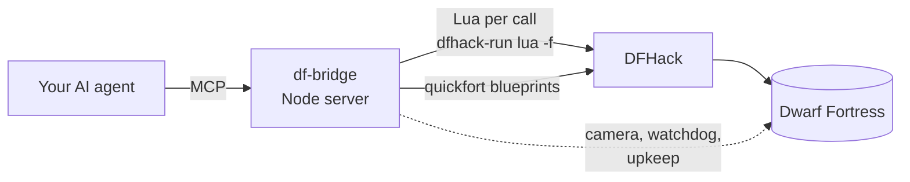

```text
    ____ _       _____    ____  ______   __________  ____  __________  ________________
   / __ \ |     / /   |  / __ \/ ____/  / ____/ __ \/ __ \/_  __/ __ \/ ____/ ___/ ___/
  / / / / | /| / / /| | / /_/ / /_     / /_  / / / / /_/ / / / / /_/ / __/  \__ \\__ \
 / /_/ /| |/ |/ / ___ |/ _, _/ __/    / __/ / /_/ / _, _/ / / / _, _/ /___ ___/ /__/ /
/_____/ |__/|__/_/  |_/_/ |_/_/      /_/    \____/_/ |_| /_/ /_/ |_/_____//____/____/
                               ___  ___  _______  _________
                              / _ )/ _ \/  _/ _ \/ ___/ __/
                             / _  / , _// // // / (_ / _/
                     =====  /____/_/|_/___/____/\___/___/    =====

                 /\                                                /\
            /\  /  \           _____________________              /  \   /\
           /  \/    \  /\     /   ##   _______  ##   \   /\      /    \ /  \
          /    \     \/  \   |    ##  |   o/  | ##    |_ /  \____/      \    \
         /      \     \   \  |    ##  |  /|   | ##    | /    \           \    \
        /        \     \   \_|____##__|__/_\__|_##____|/      \           \    \
       /__________\_____\_____________________________________\___________\____\
               ~  your AI plays ~  you watch  ~  strike the earth!  ~
```

<div align="center">

**Your AI plays Dwarf Fortress. You grab a drink and watch.**

An MCP server that gives any AI agent (Claude, Codex, OpenCode, Hermes, OpenClaw, Cursor, Gemini...) 55 tools<br>to run a real Dwarf Fortress fortress through DFHack:<br>
digging, building, trade, war and diplomacy, with a camera that follows the action for you.


</div>

---

## 🎬 What it's like

You start Dwarf Fortress, your AI takes the overseer's chair, and your screen turns into a live broadcast of your fort.

- 🗡️ **A goblin thief slips in at the map edge.** The game pauses, the camera snaps to it, and the AI sends the Hollow Guard. You watch the commander charge across the surface.
- 🏗️ **Nothing dangerous going on?** The camera tours the fort: a new bedroom wing being dug, a legendary armourer at the forge, a bard performing in the tavern.
- 🤝 **A caravan or a royal treasurer arrives.** You're there for the meeting and the haggling at the depot.
- 📜 **The AI narrates** with captions in the game's own announcement log, so you know what you're about to see.

Tell the camera what you enjoy, and it remembers:

```
df_camera like categories=["fights","hostiles","building","diplomacy"]
df_camera dislike categories=["farming"]
```

## ✨ Highlights

| | |
|---|---|
| 🎥 **Camera director** | Jumps to real fights, tracks enemies, shows arrivals, births, artifacts and moods. Tours interesting work when it's quiet, weighted by your taste. `follow` locks onto any dwarf or creature. |
| 🚨 **Watchdog** | Time runs in controlled steps that stop the instant something matters: an enemy appears, a dwarf dies, a strange mood starts or a caravan arrives. Optionally sounds the civilian alert and readies the squads by itself. |
| 📦 **Upkeep** | Keeps drink, barrels, spare furniture, goblets, soap and fuel topped up with work orders, without ever doubling an order. |
| 🧐 **Diagnosis** | `df_threats` finds disguised werebeasts and lists who killed whom. `df_mood check` says whether a strange mood can be satisfied. `df_items` explains why that barrel nobody uses is stuck. |
| 🏰 **Tidy builder** | Bedroom wings in three calls, room-value audits against the wiki's rules, overlap detection, stockpile tidiness checks. |
| ⚔️ **Military** | Squads, uniforms, schedules, patrols, burrows, levers, and an `equip` fix for the game's habit of leaving soldiers unarmed. |
| 🎲 **No cheating** | Everything goes through the game's own systems. Nothing is spawned, teleported or revealed. |

## 📖 Tales from the first fort

The bridge was built by Claude while playing, and the fort's disasters shaped the tools.

- **The well that ran dry.** The surface pool drained, so the overseer dug a one-tile shaft 40 levels down into the first cavern's lake. The well now draws from water that never runs out.
- **The werebeast.** A wereiguana arrived disguised as a human and killed four children in the pasture. Two dwarves it had bitten turned at the next full moon. Avuz the broker and Dastot the axedwarf killed them. That's why `df_threats`, the watchdog and petition vetting exist.
- **The stalled diplomat.** A royal treasurer's meeting froze the depot for days because the broker had no office worth meeting in. The overseer dug one, engraved it and furnished it in iron, and the meeting went ahead.
- **The near miss.** A search for "scepter" almost carted a strange mood's artifact off to the trade depot. `df_trade send` now refuses artifacts.
- **The yarn crisis.** A fey weaver needed wool cloth nobody had. With cheating ruled out, the answer was the dwarven caravan, and the mood ended in an artifact shirt with days to spare.

## 🚀 Quick start

1. Install **Dwarf Fortress** and the free **DFHack** app on Steam, then launch the game (the DFHack console opens with it).
2. Install the bridge (needs [Node.js](https://nodejs.org) 18+):
   ```bash
   git clone https://github.com/nutshot2000/Dwarf-Fortress-Bridge.git
   cd Dwarf-Fortress-Bridge
   npm install
   ```
3. Connect your AI (below), load or embark on a fort, and tell it to play.

If the game isn't in `D:\SteamLibrary`, set `DF_DIR` and `DFHACK_DIR` in the server's environment.

### 🔌 Connect your AI

It's a standard **MCP stdio server**: any client that speaks MCP can run it. Replace the path with yours.
`df_wait` can run for up to 50 seconds per call, so give the server a tool timeout of at least 60 seconds
(or lower `DF_WAIT_SECONDS`).

<details open>
<summary><b>Claude Code</b></summary>

```bash
claude mcp add -s user dwarf-fortress -- node /path/to/Dwarf-Fortress-Bridge/src/server.js
```
</details>

<details>
<summary><b>Codex</b> (<code>~/.codex/config.toml</code>)</summary>

```toml
[mcp_servers.dwarf-fortress]
command = "node"
args = ["/path/to/Dwarf-Fortress-Bridge/src/server.js"]
tool_timeout_sec = 120
```
</details>

<details>
<summary><b>OpenCode</b> (<code>opencode.json</code>)</summary>

```json
{
  "mcp": {
    "dwarf-fortress": {
      "type": "local",
      "command": ["node", "/path/to/Dwarf-Fortress-Bridge/src/server.js"],
      "enabled": true
    }
  }
}
```
</details>

<details>
<summary><b>Hermes Agent</b> (<code>~/.hermes/config.yaml</code>)</summary>

```yaml
mcp_servers:
  dwarf-fortress:
    command: node
    args: ["/path/to/Dwarf-Fortress-Bridge/src/server.js"]
    timeout: 120
```
</details>

<details>
<summary><b>OpenClaw</b> (<code>mcp.servers</code> in your OpenClaw config)</summary>

```json
{
  "mcp": {
    "servers": {
      "dwarf-fortress": {
        "command": "node",
        "args": ["/path/to/Dwarf-Fortress-Bridge/src/server.js"]
      }
    }
  }
}
```
</details>

<details>
<summary><b>Cursor, Claude Desktop, Gemini CLI, Windsurf and most others</b> (<code>mcpServers</code> JSON)</summary>

```json
{
  "mcpServers": {
    "dwarf-fortress": {
      "command": "node",
      "args": ["/path/to/Dwarf-Fortress-Bridge/src/server.js"],
      "env": { "DF_TOOLS": "full" }
    }
  }
}
```
Cursor: `.cursor/mcp.json` · Claude Desktop: `claude_desktop_config.json` · Gemini CLI: `~/.gemini/settings.json`
</details>

Config formats change between versions; if a snippet doesn't load, check your client's MCP docs for the current shape.

### ⚙️ Settings

All optional, set in the server's `env`:

| Variable | Default | What it does |
|---|---|---|
| `DF_TOOLS` | `full` | `full` = all 55 tools · `core` = 24 essentials for clients with tool limits or smaller models · or a comma-separated list |
| `DF_AGENT_NAME` | `Overseer` | The name on camera captions in the game's announcement log, e.g. `Codex` or `Hermes` |
| `DF_WAIT_SECONDS` | `50` | Real-time cap for one `df_wait` call; keep it under your client's tool timeout |
| `DF_DIR`, `DFHACK_DIR` | `D:\SteamLibrary\...` | Where Dwarf Fortress and DFHack live |

### 📘 The playbook

The server sends [`PLAYBOOK.md`](PLAYBOOK.md) to the model as its instructions: the turn loop, the rules (no cheating), and how to use each tool well.
Some clients don't pass server instructions on to the model. If yours doesn't, start with *"call df_help topic=playbook first"*.

## 🔧 How it works



Each tool writes a short Lua chunk and runs it through `dfhack-run`. Digging, buildings, stockpiles and zones go through DFHack's `quickfort`. There's no game mod and nothing is injected.

A turn looks like this: `df_status` → `df_problems` → one action → `df_wait upkeep=true`, with the camera showing you each step.

## Field-tested fixes (v1.4.1–1.4.3)

A full first year of play (the fort Spearmirrors: an aquifer crossing, a cavern breach, a caravan, migrant waves) turned
up rough edges that are now fixed: dig jobs that vanished from the map, ragged stockpiles, refused furniture with no
reason given, fights that stopped every wait, seasonal autosaves mistaken for open menus, and trade replies that looked
like refusals. Output is also much shorter. Lua changes now take effect without restarting the server. Details in
[CHANGELOG.md](CHANGELOG.md).

## Visual inspection (v1.4.0)

`df_screenshot` returns the actual Dwarf Fortress window as an MCP PNG image, a saved local PNG path, and text enclosure/access checks. Use `{ "x": 103, "y": 92, "z": 169 }` to centre an inspection, or `{}` to capture the current view. Pause first, inspect workers and exits after construction, and pan for large layouts. `max_width` defaults to1600 (640–2560). Images are saved under `%TEMP%/df-bridge/screenshots/`.

Capture uses built-in Windows PowerShell/.NET and PrintWindow on the game client area only; no extra package, mouse movement, foreground switch, or desktop-wide capture. Restore minimized windows; blank captures fail explicitly. Currently Windows-only. Vision-capable MCP clients receive image content; text-only models still receive layout/access results and instructions to use text tools. A screenshot is one view, and the checks are aids rather than a guarantee that every unit can move.

## Room protection and clearer diagnostics (v1.3.1)

Bedroom wings now register protected walls. Digging and blueprints reject changes through protected room boundaries unless `allow_room_changes=true` explicitly permits remodelling. `df_room_plan` protects custom layouts and audits existing bedrooms; `df_rooms` refuses to furnish or zone open rooms. Existing damaged layouts are reported for repair. `df_room_plan action=repair` previews or queues walls, then doors; `action=tidy` previews or marks eligible loose stone/gems within one room. Both default to previews. Status distinguishes pending jobs from finished enclosure, and the playbook includes repair and relocation steps.

Build previews identify invalid tiles, construction reviews distinguish allocated materials from foreign reservations, and crop/trade helpers prevent common supply mistakes. See [ISSUES-REVIEW.md](ISSUES-REVIEW.md) for reproduced issues, model mistakes, test results, and limits.

## 🧰 The 55 tools

| Group | Tools |
|---|---|
| 👀 Observe | `df_status` `df_problems` `df_units` `df_unit` `df_announcements` `df_look` `df_alerts` |
| 🧐 Diagnose | `df_threats` `df_items` `df_squad_status` `df_mood` `df_stocks` `df_designations` |
| 🏗️ Build | `df_dig` `df_build` `df_stockpile` `df_zone` `df_blueprint` `df_rooms` `df_room_plan` `df_remove` |
| ⚒️ Produce | `df_order` `df_upkeep` `df_workshop` `df_jobs` `df_crop` `df_kitchen` `df_pile` `df_dump` |
| 👥 People | `df_labor` `df_noble` `df_location` `df_standing` `df_animals` `df_petition` `df_justice` |
| ⚔️ Defence | `df_military` `df_schedule` `df_burrow` `df_levers` |
| 💰 Trade | `df_trade` |
| ⏳ Time | `df_wait` `df_pause` `df_resume` `df_save` |
| 🎥 Watch & UI | `df_camera` `df_ui` `df_screen` `df_view` `df_screenshot` |
| 🧪 Expert | `df_auto` `df_cmd` `df_lua` `df_help` |

<details>
<summary><b>🐛 v50 quirks the tools work around</b> (worth knowing if you script DFHack yourself)</summary>

- **Work orders** need a manager. If the Work orders screen says "A manager is required" although one is appointed, `df_noble action=repair` rebuilds `fortress_entity.assignments_by_type`, the index the game actually checks (found by reverse engineering the game binary). Orders also need a material, so `df_order` defaults to wood or stone.
- **Panels** (trade, squads, petitions, building sheets) live inside the main screen and ignore Esc sent from scripts; some freeze time while open. `df_ui close` shuts them, and `df_wait` names any panel that stalls the clock.
- **Popups** (weapon namings and the like) pause the game until their Okay button is clicked; `df_wait` clicks them away.
- **Engraving**: quickfort's engrave key designates nothing in v50, so `df_dig kind=engrave` sets the designation directly.
- **Uniforms**: soldiers only fetch items listed in their position's `assigned_items`. `df_military equip` fills empty slots and keeps that list in sync.
- **Kill orders** are ignored for targets the game doesn't count as hostile, like a werebeast in human form. Station the squad nearby instead.
- **Diplomats** meet nobles in an office of decent quality, or the meeting and depot trading stall. Office zones should include their walls; engraving and metal furniture raise the value.
- **Follow mode** (`plotinfo.follow_unit`) switches itself off, so the camera director follows units itself.
- **Dumps** forbid whatever lands in them; `df_dump action=unforbid` makes dumped stone usable again.
- **Linked stockpiles**: a workshop with linked "give" piles only takes from those piles.
- **Farm plots** reset to fallow when construction finishes, so set crops afterwards.
- **Damp stone**: digging next to water or a light aquifer cancels the designation once ("damp stone located");
  designating the same tiles again confirms it. Water standing on a floor also makes the rock around it "damp" and
  cancels nearby digs silently. A light aquifer drips into tiles dug directly beneath it, so the level right under an
  aquifer layer is unusable for rooms. The playbook explains crossing one with a walled shaft ring.
- **Dig jobs** clear the tile's dig flag once a dwarf takes them, so a plain map read shows rock; `df_look` overlays
  queued dig jobs.
- **Workshop queues** run front to back and ignore the job's do-now flag; `df_jobs do_now` moves the job forward.
- **Doors** need an existing wall beside them; in one blueprint with their walls they are refused until the walls are
  built.
- **Caravans** have a weight limit: stone mugs and crafts are heavy, cut gems and metal crafts are light.
- **Seasonal autosave** freezes time for a while at the start of each season.
- **Wells** need a bucket, a chain or rope, a mechanism and stone blocks. If one of them never turns up, the plan is
  dropped ("unable to complete the Well"), so make them first. A one-tile channel into a light aquifer under the well
  makes a safe water source.
- **Work details** override individual labors: re-applying one (as `df_labor detail_add` does) resets labors toggled
  by hand, and labors no detail covers (brewing, cooking) come back on. Disable them again afterwards.
- **Location names**: every location quickfort creates gets the same generated name; `df_zone` sets the requested
  name as the location's nickname.
- **Tombs** hold one body each: a big tomb zone over a row of coffins buries one dwarf and leaves the rest lying
  where they fell. Put a 1x1 tomb zone on every coffin, and remove any larger tomb zone over them: a coffin in two
  tomb zones is skipped. Ghosts rest once their engraved memorial slab is built (`~s`).
- **Gear of the dead** (citizens and invaders) is forbidden where it falls; after a fight it stays on the floor until
  unforbidden; gear the undead or invaders carried (even a raised citizen's own pick) is also flagged `foreign`,
  which haulers ignore until it is cleared. It needs a weapon/armour stockpile to go to. `df_problems` counts it.
- **Corpses and bones** lie where they fell forever: only vermin remains rot. They get cleaned up with a refuse
  stockpile or a dump zone plus the `dump_corpses/bones/skulls` standing orders; `gather_refuse_outside` starts off,
  so bodies on the surface stay even then.
- **`dfhack.workshops.getJobs`** prints a debug dump for every ore when listing smelter jobs; the bridge mutes it.

</details>

## 🛠️ Development

- `PLAYBOOK.md` is the model's operating guide, `src/core.js` holds the server, settings and helpers, `src/camera.js` the camera director, `src/tools/*.js` one file per area, and `lua/` the Lua behind each tool.
- Try one tool: `node scripts/call.mjs df_look "{\"radius\":20}"`
- Several calls in one session (the camera keeps state in the server): `node scripts/session.mjs '[["df_camera",{"action":"follow","name":"Urist"}],["df_wait",{"days":1}]]'`
- Tests: `npm test` runs every read-only tool against the running game and changes nothing; `npm run test:offline` only checks that all tools register.
- Lua files reload automatically when edited. Changes under `src/` need the MCP server restarted (reconnect it in your
  client, or stop its `node src/server.js` process if your client relaunches it). `scripts/call.mjs` always starts a
  fresh server, so it tests new JS right away.
- Notable changes per release are in [CHANGELOG.md](CHANGELOG.md).

<div align="center">

*Strike the earth!* ⛏️

</div>
