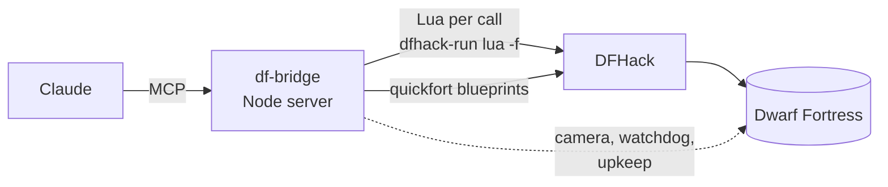

```text
            ██████╗ ██╗    ██╗ █████╗ ██████╗ ███████╗
            ██╔══██╗██║    ██║██╔══██╗██╔══██╗██╔════╝
            ██║  ██║██║ █╗ ██║███████║██████╔╝█████╗
            ██║  ██║██║███╗██║██╔══██║██╔══██╗██╔══╝
            ██████╔╝╚███╔███╔╝██║  ██║██║  ██║██║
            ╚═════╝  ╚══╝╚══╝ ╚═╝  ╚═╝╚═╝  ╚═╝╚═╝
███████╗ ██████╗ ██████╗ ████████╗██████╗ ███████╗███████╗███████╗
██╔════╝██╔═══██╗██╔══██╗╚══██╔══╝██╔══██╗██╔════╝██╔════╝██╔════╝
█████╗  ██║   ██║██████╔╝   ██║   ██████╔╝█████╗  ███████╗███████╗
██╔══╝  ██║   ██║██╔══██╗   ██║   ██╔══██╗██╔══╝  ╚════██║╚════██║
██║     ╚██████╔╝██║  ██║   ██║   ██║  ██║███████╗███████║███████║
╚═╝      ╚═════╝ ╚═╝  ╚═╝   ╚═╝   ╚═╝  ╚═╝╚══════╝╚══════╝╚══════╝

              ═════════  ╔╗ ╦═╗╦╔╦╗╔═╗╔═╗  ═════════
                         ╠╩╗╠╦╝║ ║║║ ╦║╣            
              ═════════  ╚═╝╩╚═╩═╩╝╚═╝╚═╝  ═════════

          /\                                                /\
     /\  /  \           _____________________              /  \   /\
    /  \/    \  /\     /   ##   _______  ##   \   /\      /    \ /  \
   /    \     \/  \   |    ##  |   o/  | ##    |_ /  \____/      \    \
  /      \     \   \  |    ##  |  /|   | ##    | /    \           \    \
 /        \     \   \_|____##__|__/_\__|_##____|/      \           \    \
/__________\_____\_____________________________________\___________\____\
        ~  claude plays  ~  you watch  ~  strike the earth!  ~
```

<div align="center">

**Claude plays Dwarf Fortress. You grab a drink and watch.**

An MCP server that gives Claude 50 tools to run a real Dwarf Fortress fortress through DFHack:<br>
digging, building, trade, war and diplomacy, with a camera that follows the action for you.


</div>

---

## 🎬 What it's like

You start Dwarf Fortress, Claude takes the overseer's chair, and your screen turns into a live broadcast of your fort.

- 🗡️ **A goblin thief slips in at the map edge.** The game pauses, the camera snaps to it, and Claude sends the Hollow Guard. You watch the commander charge across the surface.
- 🏗️ **Nothing dangerous going on?** The camera tours the fort: a new bedroom wing being dug, a legendary armourer at the forge, a bard performing in the tavern.
- 🤝 **A caravan or a royal treasurer arrives.** You're there for the meeting and the haggling at the depot.
- 📜 **Claude narrates** with captions in the game's own announcement log, so you know what you're about to see.

Tell the camera what you enjoy, and it remembers:

```
df_camera like categories=["fights","hostiles","building","diplomacy"]
df_camera dislike categories=["farming"]
```

## ✨ Highlights

| | |
|---|---|
| 🎥 **Camera director** | Jumps to real fights, tracks enemies, shows arrivals, births, artifacts and moods. Tours interesting work when it's quiet, weighted by your taste. `follow` locks onto any dwarf or creature. |
| 🚨 **Watchdog** | Time runs in controlled steps that stop the instant something matters: an enemy appears, a dwarf dies, a strange mood starts or a caravan arrives. Optionally sounds the civilian alert and readies the squads by itself. |
| 📦 **Upkeep** | Keeps drink, barrels, spare furniture, goblets, soap and fuel topped up with work orders, without ever doubling an order. |
| 🧐 **Diagnosis** | `df_threats` finds disguised werebeasts and lists who killed whom. `df_mood check` says whether a strange mood can be satisfied. `df_items` explains why that barrel nobody uses is stuck. |
| 🏰 **Tidy builder** | Bedroom wings in three calls, room-value audits against the wiki's rules, overlap detection, stockpile tidiness checks. |
| ⚔️ **Military** | Squads, uniforms, schedules, patrols, burrows, levers, and an `equip` fix for the game's habit of leaving soldiers unarmed. |
| 🎲 **No cheating** | Everything goes through the game's own systems. Nothing is spawned, teleported or revealed. |

## 📖 Tales from the first fort

The bridge was built while playing, and the fort's disasters shaped the tools.

- **The well that ran dry.** The surface pool drained, so Claude dug a one-tile shaft 40 levels down into the first cavern's lake. The well now draws from water that never runs out.
- **The werebeast.** A wereiguana arrived disguised as a human and killed four children in the pasture. Two dwarves it had bitten turned at the next full moon. Avuz the broker and Dastot the axedwarf killed them. That's why `df_threats`, the watchdog and petition vetting exist.
- **The stalled diplomat.** A royal treasurer's meeting froze the depot for days because the broker had no office worth meeting in. Claude dug one, engraved it and furnished it in iron, and the meeting went ahead.
- **The near miss.** A search for "scepter" almost carted a strange mood's artifact off to the trade depot. `df_trade send` now refuses artifacts.
- **The yarn crisis.** A fey weaver needed wool cloth nobody had. With cheating ruled out, the answer was the dwarven caravan, and the mood ended in an artifact shirt with days to spare.

## 🚀 Quick start

1. Install **Dwarf Fortress** and the free **DFHack** app on Steam, then launch the game (the DFHack console opens with it).
2. Install the bridge:
   ```bash
   git clone https://github.com/nutshot2000/Dwarf-Fortress-Bridge.git
   cd Dwarf-Fortress-Bridge
   npm install
   ```
3. Add it to Claude Code:
   ```bash
   claude mcp add -s user dwarf-fortress -- node /path/to/Dwarf-Fortress-Bridge/src/server.js
   ```
4. Load or embark on a fort and tell Claude to play.

If the game isn't in `D:\SteamLibrary`, set `DF_DIR` and `DFHACK_DIR`.

## 🔧 How it works



Each tool writes a short Lua chunk and runs it through `dfhack-run`. Digging, buildings, stockpiles and zones go through DFHack's `quickfort`. There's no game mod and nothing is injected.

A turn looks like this: `df_status` → `df_problems` → one action → `df_wait upkeep=true`, with the camera showing you each step.

## 🧰 The 50 tools

| Group | Tools |
|---|---|
| 👀 Observe | `df_status` `df_problems` `df_units` `df_unit` `df_announcements` `df_look` `df_alerts` |
| 🧐 Diagnose | `df_threats` `df_items` `df_squad_status` `df_mood` `df_stocks` |
| 🏗️ Build | `df_dig` `df_build` `df_stockpile` `df_zone` `df_blueprint` `df_rooms` |
| ⚒️ Produce | `df_order` `df_upkeep` `df_workshop` `df_jobs` `df_crop` `df_kitchen` `df_pile` `df_dump` |
| 👥 People | `df_labor` `df_noble` `df_location` `df_standing` `df_animals` `df_petition` `df_justice` |
| ⚔️ Defence | `df_military` `df_schedule` `df_burrow` `df_levers` |
| 💰 Trade | `df_trade` |
| ⏳ Time | `df_wait` `df_pause` `df_resume` `df_save` |
| 🎥 Watch & UI | `df_camera` `df_ui` `df_screen` `df_view` |
| 🧪 Expert | `df_auto` `df_cmd` `df_lua` `df_help` |

<details>
<summary><b>🐛 v50 quirks the tools work around</b> (worth knowing if you script DFHack yourself)</summary>

- **Work orders** need a manager. If the Work orders screen says "A manager is required" although one is appointed, `df_noble action=repair` rebuilds `fortress_entity.assignments_by_type`, the index the game actually checks (found by reverse engineering the game binary). Orders also need a material, so `df_order` defaults to wood or stone.
- **Panels** (trade, squads, petitions, building sheets) live inside the main screen and ignore Esc sent from scripts; some freeze time while open. `df_ui close` shuts them, and `df_wait` names any panel that stalls the clock.
- **Popups** (weapon namings and the like) pause the game until their Okay button is clicked; `df_wait` clicks them away.
- **Engraving**: quickfort's engrave key designates nothing in v50, so `df_dig kind=engrave` sets the designation directly.
- **Uniforms**: soldiers only fetch items listed in their position's `assigned_items`. `df_military equip` fills empty slots and keeps that list in sync.
- **Kill orders** are ignored for targets the game doesn't count as hostile, like a werebeast in human form. Station the squad nearby instead.
- **Diplomats** meet nobles in an office of decent quality, or the meeting and depot trading stall. Office zones should include their walls; engraving and metal furniture raise the value.
- **Follow mode** (`plotinfo.follow_unit`) switches itself off, so the camera director follows units itself.
- **Dumps** forbid whatever lands in them; `df_dump action=unforbid` makes dumped stone usable again.
- **Linked stockpiles**: a workshop with linked "give" piles only takes from those piles.
- **Farm plots** reset to fallow when construction finishes, so set crops afterwards.

</details>

## 🛠️ Development

- `src/core.js` holds the server and helpers, `src/camera.js` the camera director, `src/tools/*.js` one file per area, and `lua/` the Lua behind each tool.
- Try one tool: `node scripts/call.mjs df_look "{\"radius\":20}"`
- Several calls in one session (the camera keeps state in the server): `node scripts/session.mjs '[["df_camera",{"action":"follow","name":"Urist"}],["df_wait",{"days":1}]]'`
- Tests: `npm test` runs every read-only tool against the running game and changes nothing; `npm run test:offline` only checks that all tools register.

<div align="center">

*Strike the earth!* ⛏️

</div>
